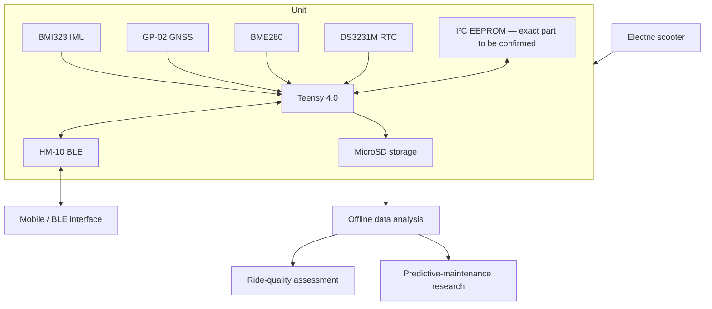
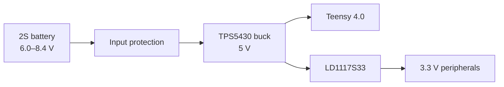

# RideDAQ
### Electric Scooter Ride Quality & Data Acquisition System

<p align="center">
  <b>Capture. Analyse. Predict.</b><br>
  An embedded data-acquisition platform for electric-scooter ride-quality monitoring and predictive-maintenance research.
</p>

<p align="center">
  
  
  
  
</p>

---

## 01. Overview

**RideDAQ** is an embedded scooter-monitoring and data-acquisition system intended to capture riding dynamics, vibration, positional information and environmental parameters. The platform combines inertial sensing, GNSS, local data logging and wireless connectivity.

The longer-term objective is to study ride quality, identify abnormal vibration patterns and investigate data-driven maintenance indicators. These are development goals, not validated capabilities at this stage.

## 02. System Architecture



## 03. Hardware

| Subsystem | Component / implementation | Role |
|---|---|---|
| Main controller | Teensy 4.0 | Acquisition and control |
| Inertial sensing | BMI323 6-DOF IMU breakout | Acceleration and angular velocity |
| Positioning | GP-02 GNSS module | Position and timing data |
| Environmental sensing | BME280 | Temperature, humidity and pressure |
| Real-time clock | DS3231M | Timestamp reference |
| Non-volatile memory | I²C EEPROM — part number requires reconciliation | Configuration / persistent data |
| Data logging | microSD | Local ride-data storage |
| Wireless interface | HM-10 BLE module | Wireless communication |
| Power | TPS5430 buck and LD1117S33 LDO in the current design | 5 V and 3.3 V rails |

**Important design note:** the current project files and earlier design notes disagree on the EEPROM part number (AT24CS32 versus AT24C512). The exact fitted/selected device must be confirmed before the BOM and firmware address map are treated as final.

## 04. Interfaces

| Interface | Intended peripherals |
|---|---|
| I²C | BMI323, BME280, DS3231M and EEPROM |
| SPI2 | microSD |
| UART2 | HM-10 BLE |
| UART3 | GP-02 GNSS |
| ADC | Battery-voltage sensing (planned / verify schematic connectivity) |
| GPIO | Status LEDs and GNSS PPS |

Pin assignments and hierarchical sheet connectivity remain subject to schematic review. Refer to the current KiCad design files rather than treating this summary as a pin-level sign-off.

## 05. Power Architecture

The current design uses a nominal 2S Li-ion battery input (6.0–8.4 V design range), input protection, a TPS5430-based 5 V buck stage and an LD1117S33 3.3 V LDO stage.



The power-stage component selection, low-input regulation margin, capacitor suitability, transient protection and thermal performance still require engineering verification. This block diagram describes the intended architecture, not a validated power-stage sign-off.

## 06. Development Status

| Workstream | Status |
|---|---|
| System architecture | Defined; under review |
| KiCad schematic | Created; electrical review pending |
| PCB placement / routing | In development; verify current board state |
| Firmware | Planned / in development |
| Sensor integration | Planned |
| SD data logging | Planned |
| BLE communication | Planned |
| Scooter pilot | Planned |
| Ride-quality analysis | Future work |
| Predictive-maintenance modelling | Future research |

## 07. Pilot Objectives

The initial pilot is intended to collect real-world scooter data and explore:

- Road-induced vibration characteristics
- Acceleration and movement patterns
- Ride-condition classification
- Abnormal vibration signatures
- Operational trends and potential maintenance indicators

No predictive-maintenance performance is claimed until supported by collected data and validated analysis.

## 08. Repository Structure

```text
RideDAQ/
├── v1/
│   ├── Hardware/
│   │   └── RideDAQ_KiCad/
│   │       └── RideDAQ_v1/
│   │           ├── RideDAQ_v1.kicad_pro
│   │           ├── RideDAQ_v1.kicad_sch
│   │           ├── RideDAQ_v1.kicad_pcb
│   │           ├── Sheets/
│   │           └── Libraries/
│   ├── Firmware/
│   └── Documentation/
├── README.md
└── .gitignore
```

The Firmware and Documentation directories will be populated as those workstreams mature.

## 09. Toolchain

- **Embedded platform:** Teensy 4.0
- **Firmware:** C / C++
- **Hardware design:** KiCad
- **Interfaces:** I²C, SPI, UART and BLE
- **Analysis:** Python (planned)

## 10. Engineering Gate Before PCB Release

Before manufacturing, complete and record:

1. Hierarchical schematic connectivity review.
2. Reconciliation of component MPNs, values, footprints and BOM.
3. Power-stage calculations and datasheet checks.
4. KiCad ERC with all errors reviewed.
5. Schematic-to-PCB consistency check.
6. Footprint, 3D model and connector-mechanical review.
7. PCB routing, copper zones and DRC.
8. Manufacturing-output review.

A successful Git push or a visually complete schematic/PCB is not evidence that ERC, DRC or electrical validation has passed.

---

**RideDAQ — Capture real-world data. Understand vehicle behaviour. Explore predictive maintenance.**
