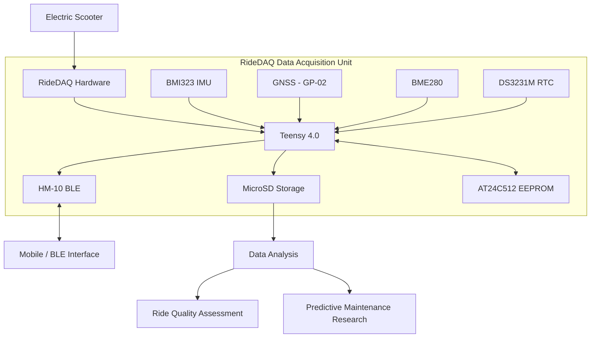
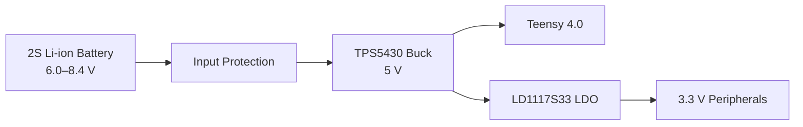

# RideDAQ
### Electric Scooter Ride Quality & Data Acquisition System

<p align="center">
  <b>Capture. Analyse. Predict.</b>
  <br>
  An embedded data acquisition platform for electric scooter ride-quality monitoring and predictive maintenance.
</p>

<p align="center">
  
  
  
  
</p>

---

## 01. Overview

**RideDAQ** is an embedded scooter monitoring and data acquisition system designed to capture real-world riding dynamics, vibration characteristics, positional information, and environmental parameters.

The system combines inertial sensing, GNSS, embedded data logging, and wireless connectivity to collect ride data for subsequent analysis.

The long-term objective is to investigate data-driven methods for ride-quality assessment, abnormal vibration detection, and predictive maintenance.

## 02. System Architecture



## 03. Hardware Architecture

| Subsystem | Component | Purpose |
|---|---|---|
| Main Controller | Teensy 4.0 | Central processing and data acquisition |
| Inertial Sensing | BMI323 6-DOF IMU | Acceleration and angular velocity |
| Positioning | GP-02 GNSS | Geographic position and timing data |
| Environmental | BME280 | Temperature, humidity and pressure |
| Real-Time Clock | DS3231M | Timestamp reference |
| Non-volatile Memory | AT24C512 | Configuration and persistent data |
| Data Logging | MicroSD | Local ride-data storage |
| Wireless Interface | HM-10 BLE | Wireless data communication |
| Power Management | Buck Converter + LDO | Regulated power distribution |

## 04. Data Acquisition & Communication

The hardware is organised around dedicated communication interfaces:

| Interface | Connected Peripherals |
|---|---|
| I²C | BMI323, BME280, DS3231M, AT24C512 |
| SPI | MicroSD Card |
| UART2 | HM-10 BLE |
| UART3 | GP-02 GNSS |
| ADC | Battery Voltage Monitoring |
| GPIO | Status LEDs, GNSS PPS |

### Data Flow

1. Acquire inertial measurements from the BMI323.
2. Receive GNSS position and timing information.
3. Monitor environmental parameters.
4. Associate acquired measurements with timestamps.
5. Store collected data on the microSD card.
6. Provide wireless communication through BLE.
7. Analyse recorded datasets for ride-quality and maintenance insights.

## 05. Power Architecture

The system uses a regulated multi-rail power architecture.



Key design considerations:

- Reverse-polarity protection
- Input transient protection
- Regulated 5 V and 3.3 V rails
- Battery voltage monitoring
- EMI-conscious PCB design
- Automotive-style vibration and environmental considerations

## 06. Development Objectives

| Stage | Objective | Status |
|---|---|---|
| 01 | Hardware architecture | In progress |
| 02 | Schematic and PCB development | In progress |
| 03 | Sensor integration | Planned |
| 04 | Firmware development | Planned |
| 05 | SD data logging | Planned |
| 06 | BLE communication | Planned |
| 07 | Scooter pilot data collection | Planned |
| 08 | Ride-quality analysis | Planned |
| 09 | Predictive maintenance modelling | Future scope |

## 07. Pilot Deployment

The initial objective is to deploy RideDAQ on an electric scooter for a controlled pilot data-collection period.

The collected datasets will be used to explore:

- Road-induced vibration characteristics
- Acceleration and movement patterns
- Ride-condition classification
- Abnormal vibration signatures
- Long-term operational trends
- Predictive maintenance indicators

## 08. Repository Structure

```text
RideDAQ/
│
├── v1/
│   ├── Hardware/
│   │   └── RideDAQ_KiCad/
│   │       └── RideDAQ_v1/
│   │           ├── RideDAQ_v1.kicad_pro
│   │           ├── RideDAQ_v1.kicad_sch
│   │           ├── RideDAQ_v1.kicad_pcb
│   │           └── Sheets/
│   │
│   ├── Firmware/
│   └── Documentation/
│
├── README.md
└── .gitignore
```

*Repository structure will evolve as the firmware and documentation are added.*

## 09. Technology Stack

- **Embedded Development:** C / C++
- **Microcontroller:** Teensy 4.0
- **Hardware Design:** KiCad
- **Communication:** I²C, SPI, UART, BLE
- **Data Acquisition:** IMU, GNSS and environmental sensors
- **Data Analysis:** Python (planned)

## 10. Project Vision

RideDAQ aims to establish a practical embedded data acquisition platform for understanding electric scooter behaviour under real-world operating conditions.

By combining reliable sensor acquisition, structured data logging, and analytical techniques, the project will explore the relationship between ride dynamics, vehicle usage, and potential maintenance requirements.

---

<p align="center">
  <b>RideDAQ</b>
  <br>
  Capture real-world data. Understand vehicle behaviour. Explore predictive maintenance.
</p>
